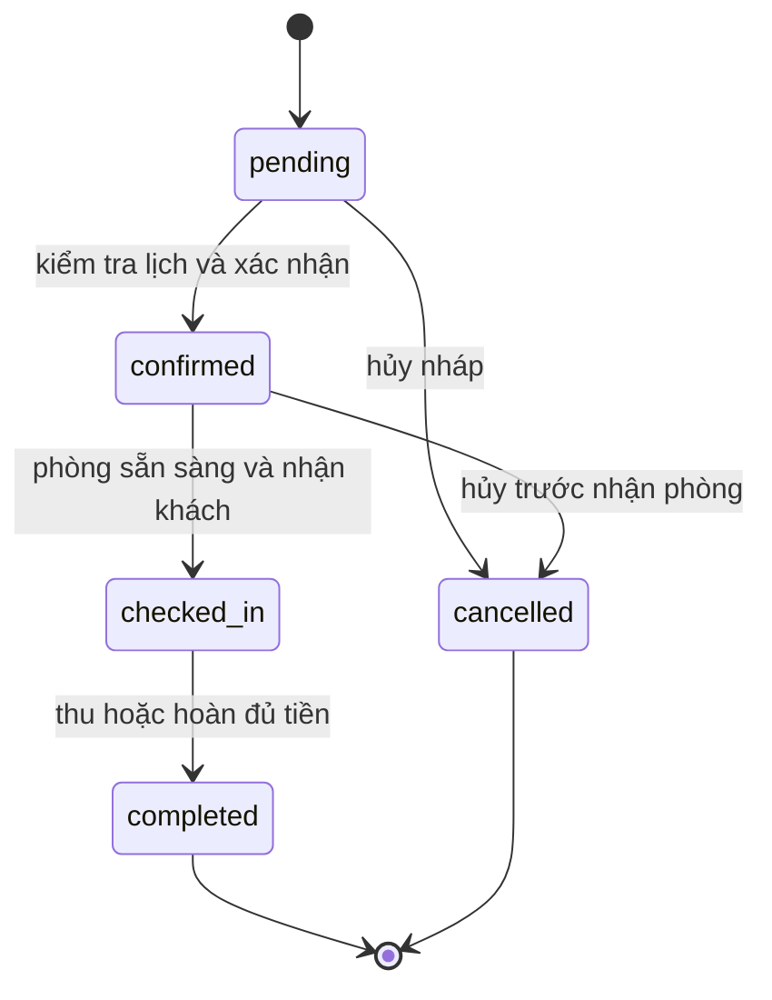

# Phạm vi và quy tắc Phase 1

Trong tên file Word, Phase1 là đề cương phân tích thiết kế. Trong lộ trình phát triển web, Phase 1 ở đây tương ứng tuần 1: chuyển đề cương thành nền tảng có thể chạy và các đặc tả để ba thành viên làm tiếp. Hoàn tất nền tảng không đồng nghĩa hoàn tất sản phẩm quản lý khách sạn.

## Căn cứ từ Word

Một khách sạn; hai vai trò trực tiếp là quản trị viên và lễ tân; khách hàng là tác nhân nghiệp vụ gián tiếp. Bảy module: phòng/loại phòng, khách hàng, đặt phòng, dịch vụ, hóa đơn/thanh toán, khuyến mãi và báo cáo. Dữ liệu dùng MongoDB với tám collection nghiệp vụ, có nhúng, tham chiếu và snapshot.

## Phần hiện thực của Phase 1

Đăng nhập, phiên, kiểm tra quyền, tạo/khóa tài khoản và đổi mật khẩu. Danh mục phòng mẫu đọc được từ MongoDB. Tám schema và chỉ mục ban đầu có trong mã nguồn. Các màn hình nghiệp vụ sau được đặc tả nhưng chưa có API ghi.

## Quy tắc làm cơ sở phát triển tiếp

Những dòng ghi “đề xuất” là mặc định thiết kế để nhóm tiếp tục; chưa có xác nhận riêng từ giảng viên. Chúng được tách khỏi yêu cầu gốc và chưa áp dụng thành logic đặt phòng/thanh toán ở Phase 1.

| Mã | Quy tắc | Căn cứ và trạng thái |
|---|---|---|
| BR01 | Một booking được chọn nhiều phòng | Word, đưa vào schema |
| BR02 | Các phòng trong cùng booking nhận và trả đồng thời | Đề xuất giới hạn bản đầu |
| BR03 | Nhận 14:00, trả 12:00; ngày nghiệp vụ giờ Việt Nam | Đề xuất, timezone có cấu hình |
| BR04 | Giá VND số nguyên; số đêm là chênh lệch ngày lịch, tối thiểu 1 | Đề xuất cụ thể hóa Word; tiền có validation schema |
| BR05 | pending là nháp không giữ lịch; confirmed/checked_in giữ lịch | Đề xuất; trạng thái có enum, chuyển trạng thái chưa viết |
| BR06 | Phòng đang dùng hôm nay vẫn có thể đặt ngày tương lai nếu lịch không trùng | Đặc tả cho tra cứu Phase 2 |
| BR07 | Giá phòng chốt lúc xác nhận, giá dịch vụ chốt lúc phát sinh | Cụ thể hóa snapshot trong Word |
| BR08 | Tỷ lệ cọc mặc định 30% tiền phòng | Đề xuất; DEPOSIT_PERCENT=30, chưa có API nhận cọc |
| BR09 | Hủy trước check-in có lý do; cọc cần quản trị duyệt hoàn | Đề xuất quy trình; chưa hiện thực |
| BR10 | Mỗi hóa đơn một mã giảm; kiểm tra thời hạn, tối thiểu và trần giảm | Cụ thể hóa Word |
| BR11 | Doanh thu hóa đơn gồm cả phần đã cọc; dòng tiền thống kê theo lúc nhận/hoàn | Đề xuất định nghĩa báo cáo để tránh cộng thiếu/trùng |
| BR12 | SĐT và giấy tờ khách duy nhất sau chuẩn hóa | Word; unique index đã có, chuẩn hóa nghiệp vụ làm ở Phase 2 |
| BR13 | Hóa đơn gốc không sửa đè; điều chỉnh có lịch sử và tham chiếu | Cụ thể hóa quyền điều chỉnh của quản trị |
| BR14 | Chỉ quản trị sửa danh mục/dọn xong; lễ tân xem | Bám ma trận quyền Word; Phase 1 chỉ đọc danh mục |

## Ví dụ đối chiếu trước khi lập trình tính phí

Khách ở hai đêm với giá 1.200.000đ/đêm, dùng dịch vụ 100.000đ, giảm 200.000đ và đã cọc 500.000đ. Tổng hóa đơn 2.300.000đ; khoản cần thu thêm 1.800.000đ. Nếu cọc lớn hơn tổng hóa đơn sau điều chỉnh, hiển thị khoản phải hoàn, không tự thu số âm.

Hai booking cùng phòng: lượt A nhận ngày 10 trả ngày 12; lượt B nhận ngày 11 trả ngày 13 thì trùng. B nhận ngày 12 thì không trùng khoảng đêm. Việc giao phòng vẫn phải chờ lượt A trả và xác nhận dọn xong.

## Sơ đồ trạng thái dự kiến

Gia hạn là thay đổi ngày trả trong checked_in sau khi kiểm tra xung đột, không phải tự chuyển trạng thái. Thay đổi do thời gian trôi qua không tự hoàn tất booking.

## Tiêu chí kết thúc Phase 1

Dự án chạy được trên máy hiện tại; đăng nhập admin/staff; API bảo vệ quyền; dữ liệu còn trên đĩa; thử được transaction; có đặc tả dữ liệu/API/màn hình và kiểm thử nền tảng. Việc chạy trên máy của Sang và Đăng cùng xác nhận các đề xuất nghiệp vụ cần nhóm thực hiện ở buổi làm chung tiếp theo.
