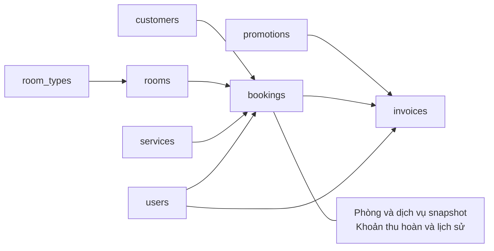

# Mô hình dữ liệu và nền tảng kỹ thuật

Schema thực tế ở `server/models.ts`. Tên trường trong MongoDB dùng snake_case; kết quả API dùng camelCase qua bước chuyển đổi rõ ràng. Tên collection cố định, không phụ thuộc cách tự số nhiều của thư viện.

## Quan hệ dữ liệu

Mũi tên mô tả quan hệ tham chiếu hoặc nguồn dữ liệu snapshot, không phải khóa ngoại do MongoDB tự cưỡng chế. Service nghiệp vụ phải kiểm tra đối tượng tham chiếu tồn tại và còn hoạt động.

| Collection | Dữ liệu chính | Hiện trạng Phase 1 |
|---|---|---|
| users | Username, hash, họ tên, role, status, session_version | Dùng thật cho xác thực và quản trị |
| room_types | Mã loại, tên, giá đêm, sức chứa, tiện ích | 3 loại mẫu |
| rooms | Số phòng, tầng, loại, trạng thái, schedule_version, khoảng ngừng phục vụ | 12 phòng mẫu, API chỉ đọc |
| customers | Tên, số giấy tờ, điện thoại, email, quốc tịch | Schema/index, chưa có CRUD |
| services | Mã, tên, đơn vị, giá và trạng thái | 6 dịch vụ mẫu, chưa có UI nghiệp vụ |
| bookings | Khách, phòng nhúng, lịch, dịch vụ, payments, trạng thái, history | Schema/index, collection rỗng |
| promotions | Mã, kiểu giảm, giá trị, hiệu lực, tối thiểu/tối đa | Schema/index, collection rỗng |
| invoices | Booking/customer tham chiếu, snapshot, các tổng tiền và điều chỉnh | Schema/index, collection rỗng |

`sessions` là collection kỹ thuật của express-session/connect-mongo; không tính thành module nghiệp vụ thứ chín. `_phase1_probe` chỉ dành cho chẩn đoán transaction, không lưu thông tin khách.

## Quyết định dữ liệu

RoomType, Customer, Service, User có vòng đời độc lập nên dùng ObjectId tham chiếu. Mảng rooms_booked và services_used có giới hạn theo một lượt lưu trú nên nhúng trong booking. Mỗi phòng/dịch vụ ghi cả ID gốc và tên/giá đã chốt. Hóa đơn cũng giữ customer_id để nhóm theo người thật, đồng thời giữ tên snapshot để không đổi lịch sử.

payments dự kiến chứa khoản cọc, thu cuối, hoàn và điều chỉnh. Mỗi dòng có request_id, số tiền, hướng in/out, phương thức, người và thời điểm. history lưu chuyển trạng thái. Các schema này chưa tự cung cấp idempotency; Phase 3–4 phải viết cập nhật có điều kiện và kiểm thử gửi lặp.

Tiền là số nguyên không âm trong giới hạn Number.MAX_SAFE_INTEGER. Điện thoại, giấy tờ và số phòng là chuỗi. Timestamp ghi UTC, trình bày theo Asia/Ho_Chi_Minh. Các document có created_at, updated_at và version để hỗ trợ cập nhật có kiểm soát.

## Chỉ mục đã khai báo

Unique: users.username, room_types.type_code, rooms.room_number, customers.phone/id_card, services.service_code, bookings.booking_code, promotions.code, invoices.invoice_code/booking_id. Có chỉ mục kết hợp cho phòng theo trạng thái/loại, booking theo phòng/trạng thái/ngày, lịch sử khách và hóa đơn theo thời điểm thanh toán.

Khởi động gọi createIndexes, không dùng syncIndexes để tránh xóa chỉ mục ngoài danh sách do người khác thêm. Ở Phase 2–5 cần đo explain với truy vấn và dữ liệu thật trước khi kết luận chỉ mục tối ưu. Unique booking_code hay chỉ mục ngày không ngăn được hai khoảng lịch giao nhau.

## MongoDB phát triển

Một replica set local tên hotel-local, cổng 27027, chỉ nghe 127.0.0.1, WiredTiger, dữ liệu ở .local/mongo. Đây là cấu hình phát triển một node để chạy transaction, không mô phỏng tính sẵn sàng cao của cluster production.

`pnpm db:check` thử hai nhánh: transaction bị lỗi phải rollback; transaction thành công phải có bản ghi. Script dọn đúng marker do lần chạy đó tạo. Kiểm thử tự động dùng một replica set tạm riêng.

## Các vấn đề phải xử lý ở giai đoạn nghiệp vụ

- Chống hai nhân viên cùng xác nhận một phòng: mọi đường thay đổi lịch ghi chung schedule_version của phòng trong transaction, kiểm tra lại lịch và thử lại khi write conflict.
- Kiểm tra sức chứa từng phòng, ngày nhận/trả, trạng thái trước chuyển bước.
- Khi thu tiền, cùng giao dịch ghi hóa đơn, khoản thu, booking và trạng thái phòng; kiểm tra version để không bỏ sót dịch vụ vừa thêm.
- Ngăn sửa snapshot/hóa đơn gốc bằng giới hạn đường cập nhật tại service/API. Schema hiện tại chưa đánh dấu tất cả trường immutable.
- Kiểm tra các tổng tiền khớp chi tiết và giới hạn độ dài lịch sử; tăng quy mô mới cân nhắc tách collection.

Tài liệu chính thức tham khảo: [MongoDB transaction requirements](https://www.mongodb.com/docs/manual/core/transactions-production-consideration/), [MongoDB Node driver transactions](https://www.mongodb.com/docs/drivers/node/v6.7/crud/transactions/), [mongodb-memory-server](https://github.com/typegoose/mongodb-memory-server).
